# Utility Suite: state of the mod (2026-11-20)

Client-side automation, resource-planning and accessibility mod for Minecraft 1.21.1 / NeoForge 21.1.265 (Java 21).
This write-up covers what is built, what it looks like in game, how it performs, and every known limitation.

**At a glance**

| | |
|---|---|
| Code | 335 main source files (~39k lines), 21 modules, 11 mixins |
| Unit tests | 423 passing, 0 failing (`./gradlew test`) |
| In-world playtest | 13 scenarios; all pass on the latest clean run (`./gradlew runPlaytest`) |
| Baritone | 1.11.3, optional (mod id `baritoe`); everything that walks the player needs it |
| Intended use | your single-player worlds and your own whitelisted server |

All screenshots below were captured by the playtest harness in a real dev client (survival, seed 8675309), not mocked.

> **Evening update: Phase 2 Milestone 1 merged (main).** Sections 1–4 below describe the afternoon baseline; these
> items from them are now fixed. Latest numbers: 468 unit tests green; playtest all scenarios pass (the one check
> that failed last run was a wording bug in the test itself, fixed); full run in
> [playtest-2026-11-20-phase2-m1.md](playtest-2026-11-20-phase2-m1.md).
>
> - **Gather from nothing works.** The coal test now starts with an empty inventory and a fresh recipe book and is
>   only given `gather 4 coal`. It ran Wood → Planks → Crafting Table → Sticks → Wooden Pick → Mine 4 Coal →
>   Return and finished with +4 coal. Getting there found and fixed four real bugs: the replan budget never capped
>   repeated repairs (35 replans in a loop), crafts didn't wait for vanilla's recipe-unlock packet, oak planks were
>   demanded when the player chopped jungle/birch logs, and the crafting-table spot search failed inside a tree
>   canopy.
> - **Stop-All now stops all pathing** (waypoint Go, Take Me Back, schematic walk-to-site, autopilot overland all hold
>   leases; the Baritone adapter cancels everything on Stop-All). Ranked issue #1 closed.
> - **OreSim:** worker allocation ~680 → ~117 MB/s; large ore veins modelled. Recall 0.62 → **0.98** (deepslate iron
>   ~30% → 100%), precision 0.55 → 0.72.
> - **Cost profiles** now plan differently (SAFEST adds food/sword prep and avoids ore below Y=-50; CHEAPEST and
>   PRESERVE_TERRAIN save good tools); typed goals respect the routing source; `travel to <waypoint>` converts 8:1.
> - **UI:** title/goal-bar gap, two-line waypoint rows, opaque window (the "ghost text" was chat bleeding through),
>   menu auto-close fix, Quick actions cards for Freecam, Water Walk, Step, NoSlowdown, Take Me Back, combat
>   arm/retreat. The menu "opening by itself" during playtests was a real Right Shift press reaching the game window
>   (the new open log shows the key physically held), most likely typing while the window had focus.
> - Still open: schematic Build Assist stalled at 9/10 once (passed on rerun), "Start freecam" button truncated,
>   portal routing. Full list in [ROADMAP.md](ROADMAP.md).

---

## 1. What it looks like

### Menu (Right Shift)

The dark-glass dashboard: top bar with the Goal Console, Clean-Screen switch and Stop-All pill; sidebar tabs with a
status footer; scrollable setting cards generated from each module's settings.

| Jobs | World |
|---|---|
| 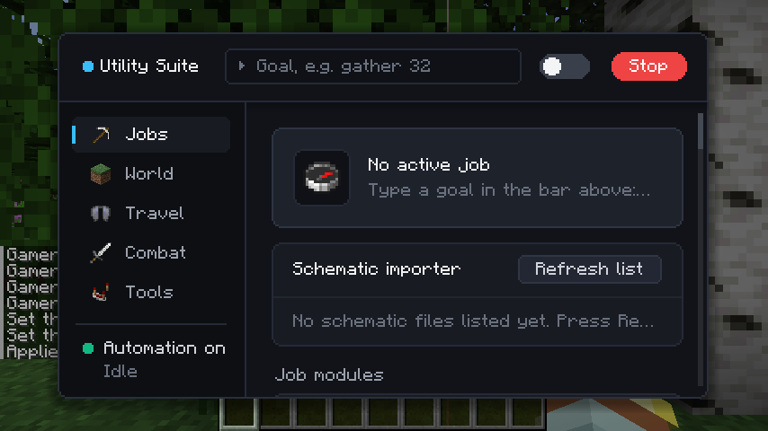 | 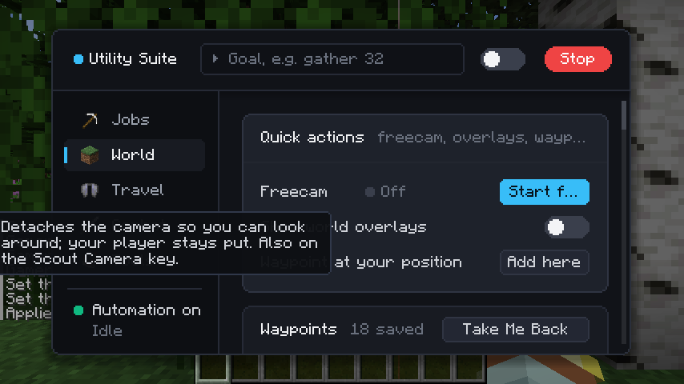 |
| **Travel** | **Combat** |
| 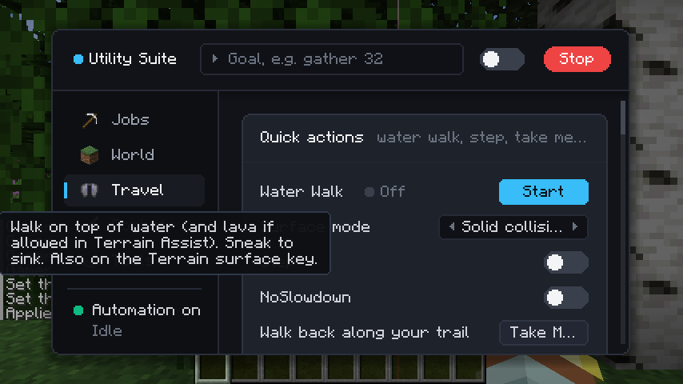 | 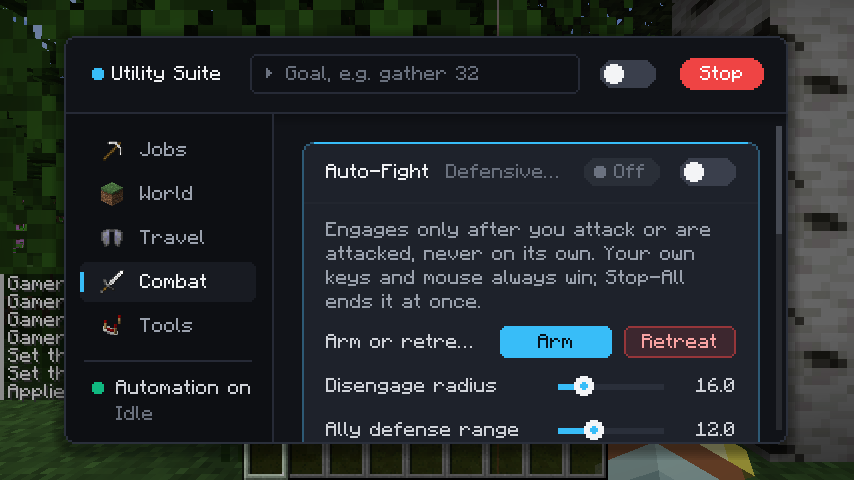 |
| **Tools** | |
| 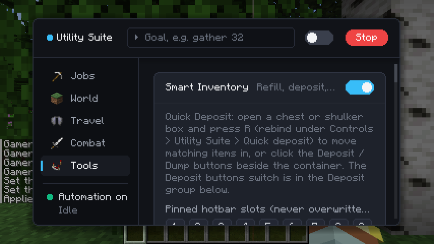 | |

### HUD while a job runs

One status pill at the top: dot, item icon, progress, current step. Nothing is drawn when idle or in Clean-Screen.

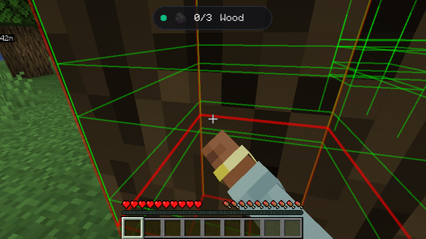

### Schematic Build Assist and ghost preview

Cyan outlines are blocks still to place; Build Assist places what it can see from where you stand.

| Mid-build | Finished |
|---|---|
| 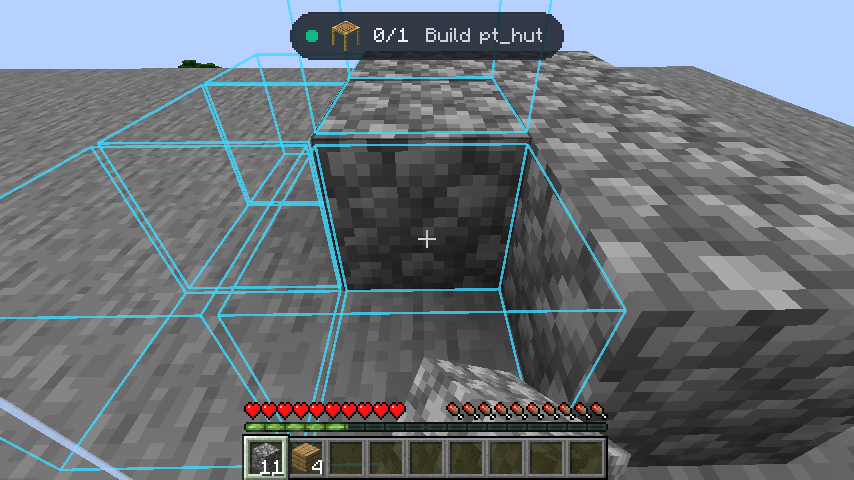 | 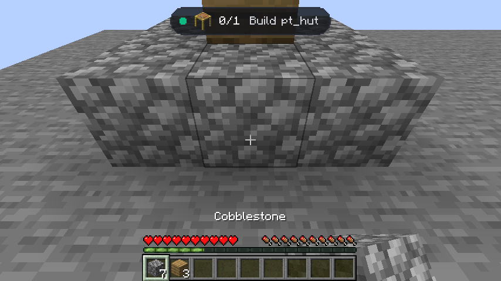 |

### World overlays (X-ray filters, caves, fluids, OreSim)

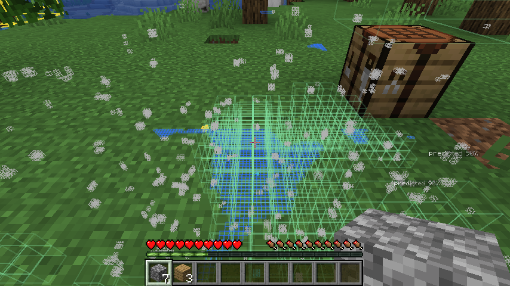

Green boxes are cave cells, blue grids are fluid pockets, white dashed speckles are OreSim predictions with a
confidence label. **Honest read: with caves + fluids + OreSim all on at once it is visually noisy**; each layer is
readable alone, together they bury the terrain. Worth a "one layer at a time" preset or dimmer cave lines.

### Travel and combat

| Bridge Assist (stopped at its 5-block budget) | Water Walk |
|---|---|
| 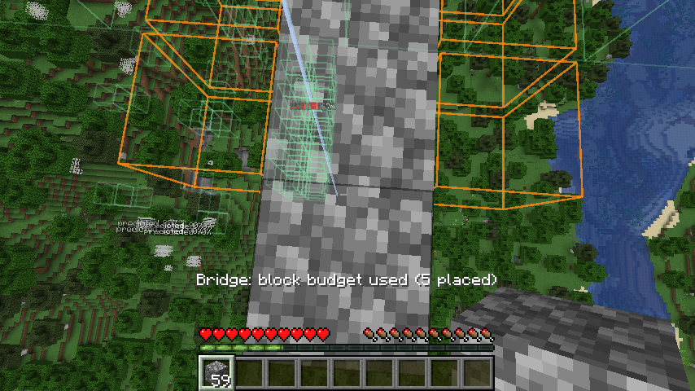 | 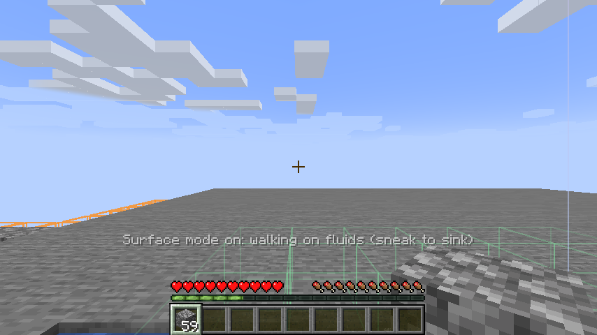 |

| Combat Assistant engaged (after your first hit) |
|---|
| 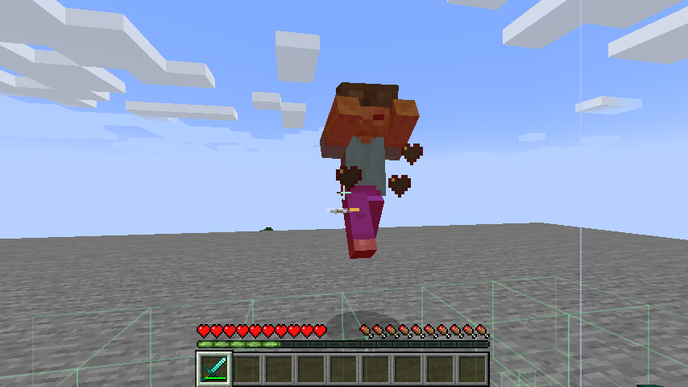 |

---

## 2. Performance (latest clean run, Spark, saved to file only)

| | Baseline (all modules off) | Stress (overlays + radar + OreSim + hazards + coach + goal job) |
|---|---|---|
| Client tick mean | 2.60 ms | 3.64 ms (+1.04) |
| Client tick p95 | 3.09 ms | 5.28 ms |
| Suite modules' own onTick | ~0.6 µs | ~79 µs total (terrain_assist 19.3, goal_engine 15.7, suite_hud 13.6, world_knowledge 7.4, seed_oresim 7.2) |
| Frame rate | 74 fps | 97 fps |

- The module code itself costs well under 0.1 ms per tick. Most of the stress tick increase is Baritone pathing and
  chunk loading from the goal job, which the measurement can't separate.
- Frame rate is not a reliable comparison between these two windows (the baseline window ran slower this time;
  the previous run showed 92 → 78 fps). Use the tick numbers.
- **Open hotspot:** the `UtilitySuite-World` thread allocates ~650–680 MB/s while OreSim simulates chunks (the
  per-column height oracle `generator.getBaseHeight`). It stops once the radius is done and doesn't touch the client
  thread, but it breaks the zero-allocation mandate and is the top perf fix.
- Fixed during playtesting: OreSim stale tasks (~720 MB/s), overlay render allocation (296 → ~31 MB/s).

---

## 3. Features and limitations

Module defaults are per profile (one profile per world/server). **(inferred)** = read from code, not seen in game.

### Mod-wide

- Client-only. Baritone is optional, but without it every walking feature fails or is refused: gather/mine jobs,
  travel goals, overland autopilot, waypoint Go, Take Me Back, schematic "walk to site", reaching tables/furnaces/chests.
- 11 mixins (silent rotation, mouse look, damage packet, position correction, fluid surface ×2, SafeWalk, block-face
  hiding, client block updates, freecam turn, fullbright). All are force-applied at dev startup by the mixin audit.

### Core

- **Action Arbiter (control leases):** four channels (movement, camera, hotbar, world interact), priorities
  Manual > Emergency > Combat > Survival > Travel > Goal > Idle. All-or-nothing grants, preemption by strictly higher
  priority, resume notifications.
  - Limitations: one lease per module; at most 32 remembered resumable leases; nothing auto-resumes after Stop-All or
    a timeout; **some pathing runs without any lease** (waypoint Go, Take Me Back, schematic walk-to-site, overland
    autopilot), so those are not coordinated with other automation (inferred).
- **Stop-All (Backspace):** revokes every lease, releases keys, tells every module.
  - Limitations: resume only from the menu (the key doesn't toggle back); goal engine pauses only the active job;
    **Baritone pathing started by waypoint Go / Take Me Back / walk-to-site is not cancelled** (inferred: no lease, no
    listener). This is the most important safety gap.
- **Manual override:** your keys, clicks, scroll and mouse look end any non-emergency lease on that channel, then a
  pause (20 ticks default) blocks re-grabs.
  - Limitations: ignored while a screen is open (except Smart Inventory's menu movement); mouse movement during a
    SILENT rotation is never an override, by design.
- **Input Smoother:** the only path for automated input; Bézier camera curves with easing, overshoot and drift
  (240°/s base), gaussian spacing.
  - Limitations: one container click per tick; 64-entry click queue; crafting goes through vanilla recipe-book placement.
- **Keybinds:** Right Shift menu, Backspace Stop-All, F10 Clean-Screen, Z zoom, R Quick Deposit (in containers).
  - Limitations: unbound by default: Water Walk, overlays toggle, freecam, combat arm/retreat, autopilot, bridge,
    add waypoint, Take Me Back. **Water Walk and freecam have no menu button**, so they're unusable until bound (inferred).
- **Profiles:** `global.json` + `sp_<save>.json` / `mp_<host>_<port>.json`, atomic debounced writes off-thread,
  corrupt files moved aside; copy settings between profiles.
  - Limitations: core settings (clean screen, override pause, mouse threshold, camera speed) are global only.
- **Module registry:** a module that throws in `onTick` is disabled and logged instead of retried.

### Jobs: Goal Console and planner

- **Goal Console:** typed goals with a dry-run preview (Enter), then Enter/Start to queue.
  - Verbs: `gather|mine|collect|get|obtain|dig [qty] item`, `craft|make|smelt [qty] item`, `build <schematic>`,
    `goto x y z` (with `~`), `go|travel|walk [to] <coords|waypoint>`.
  - Modifiers: `cost=fastest|safest|cheapest|preserve_terrain`, `source=observed|simulated|hybrid`,
    `anchor=x,y,z`, `gather-only`. Fuzzy item names ("iron pick", plurals, small typos).
  - Limitations:
    - One job runs at a time; jobs are world-scoped and don't survive leaving the world.
    - `Custom` goals are unsupported; phrases like "ingots of iron" don't parse.
    - **Cost profiles barely differ:** only PRESERVE_TERRAIN changes the plan (planks instead of coal for fuel);
      FASTEST/SAFEST/CHEAPEST plan identically (inferred).
    - Typed goals default to HYBRID data and ignore the World tab's routing setting (inferred inconsistency).
    - Travel goals ignore dimension; `travel to <waypoint>` uses raw coordinates, not the 8:1 Nether conversion
      (the autopilot and World tab Go do convert) (inferred).
- **Dependency planner:** recursive bootstrap (logs → planks → table → wooden pick → cobble → stone pick + furnace
  → iron …), inventory first, then remembered storage, then producing; plans fuel; batches errands across queued jobs.
  - Limitations: recipe depth cap 24; harvest table covers vanilla logs/stems, stone types, dirt/sand/gravel/clay,
    netherrack, all vanilla ores, obsidian, debris. **Anything else (mob drops, plants, wool, …) is "No known source".**
    Crafting/smelting/blasting/smoking only (no stonecutter, smithing or special recipes). Crafting needs the recipe
    unlocked in your recipe book. Fortune/drop counts are estimates (progress is measured by real inventory).
- **Job executor:** gather, mine, craft, smelt, fetch, return, travel, build steps; stuck detection and targeted
  repair (tool broke, chest empty, craft failed); resumes from a checkpoint after being preempted.
  - Limitations: pauses after 3 replans with a diagnostic; container open times out after 10 s; SIMULATED-only data
    pauses when there are no candidates in range.
- **Baritone adapter:** autoTool on, chat control off; mine / goTo / goToBlock / follow path only.
  - Limitations: Baritone 1.11.3 can't avoid areas, so **protected areas are enforced reactively**: the path is
    checked every 10 ticks and cancelled if it would break a protected block, then the job replans.
- **Storage Memory:** remembers chest, trapped chest, barrel, ender chest and shulker contents when you close them;
  stale after the block is gone or 72 h.
  - Limitations: position comes from your last right-click (the client can't tell which block a screen is), so other
    opening methods can mis-attribute; hoppers/dispensers aren't indexed; ender chest stored per position, not per
    player (inferred).
- **Survival Autopilot** (off by default): Auto-Tool, valuable-tool protection, Auto-Eat, lava guard, junk dropping,
  compact-into-blocks, protected areas, death recovery.
  - Limitations: hotbar only for tools and food; lava guard only while the goal engine holds movement (not for your
    own walking or the autopilot); death recovery travels same-dimension only and has no explicit pick-up step
    (inferred); does nothing in creative or during Stop-All.

### Schematic Toolkit

- Imports `.litematic` (v4–7, multi-region), Sponge `.schem` (v1–3), vanilla `.nbt`. Bill of materials with
  substitutions, live diff vs inventory/storage/world, site survey, layered build order with scaffolding, staging
  plan, Build Assist, ghost preview, gather-only mode.
- Limitations:
  - No legacy MCEdit `.schematic`; caps 16 M cells / 512 MB NBT; blocks from missing mods never match.
  - **No rotation or mirroring**; anchor defaults to your position. One job at a time.
  - One automatic gather round per build; the second pass builds with what's available.
  - **Wrong blocks are never broken**, only its own scaffold. **Block states (facing, half, axis) aren't enforced**:
    the right block in the wrong orientation counts as placed (inferred).
  - **Build Assist doesn't walk around the build**: blocks hidden from where you stand are skipped until you move (the
    card says so). Walk-to-site only triggers beyond 32 blocks and needs Baritone.
  - Staging is a plan only; nothing carries items to the project chests.
  - Fluids, fire, portals, crops are notes, not gathered; unobtainable blocks are listed separately; waterlogging
    never adds a water bucket. Scaffold gaps taller than 12 are reported, not solved.

### World

- **World Knowledge:** keeps observed blocks and seed predictions separate; verifies predictions near you; suppresses
  veins after misses; on servers trusts only exposed blocks (anti-xray can disguise ores as stone).
- **World Overlays / X-ray filters** (off): presets from rare ores to everything, custom block ids, caves, fluids.
  - Limitations: only loaded chunks; anti-xray servers hide ores. "Hide other blocks" works only with the vanilla
    renderer (greyed out with Sodium/Embeddium) and rebuilds every chunk when toggled. Readability with all layers on
    is poor (see screenshot).
- **World Radar** (off): players (health/armour/distance), storage, spawners, rare drops, aim arc for projectiles,
  new-chunk trails.
  - Limitations: 256 ground items max; new-chunk trails are a fluid-update heuristic that can't classify chunks
    without fluids and can be wrong.
- **Seed Workbench + OreSim** (off): re-implements vanilla 1.21.1 ore placement per chunk off-thread; seed from the
  integrated server, `/seed`, or typed; checks the seed against what you've seen.
  - Accuracy this run: precision 0.55, recall 0.62 overall (diamond 378 of 471 real found). Earlier run: 0.79 / 0.63.
  - Limitations: Overworld and Nether only; vanilla worldgen only (datapacks/mods break it, auto-flagged only in
    single-player); on multiplayer terrain and biome are unknown so accuracy drops (inferred). **Large ore veins
    (deep iron/copper) aren't modelled** (deepslate iron recall ~30%). Cave air carved later is invisible to it.
    Stone/deepslate boundary approximated at Y=0. The ~650 MB/s allocation above.
- **Scout Camera** (off): freecam, zoom (hold Z, scroll), fullbright, declutter (fire, pumpkin, portal, fog).
  - Limitations: freecam key unbound by default.
- **Waypoints** (on): groups, Overworld↔Nether 8:1, beacons, automatic death sites, breadcrumbs, Take Me Back.
  - Limitations: no rename/regroup in the UI ("Add here" always files under Bases); list shows 30; Go and Take Me
    Back need Baritone, hold no lease, and aren't stopped by Stop-All (inferred).

### Travel

- **Terrain Assist** (off): SafeWalk (on within the module), Edge Jump, Step, NoSlowdown, hazard overlay, Water Walk.
  - Limitations: **Step and NoSlowdown aren't restricted to single-player in code** (only the tooltip says so); other
    servers will correct you (inferred). Only Water Walk has the correction guard (off after 3 rubber-bands). Water
    Walk is only reachable through its unbound key. Hazards are feet-level heuristics.
- **Travel Autopilot:** routes to coords or waypoints with multiple stops; overland (Baritone), boat, elytra (takeoff,
  terrain following, rockets, landing search), experimental Nether bounce; stops at health/food budgets.
  - Limitations: no portal routing; elytra refused under a ceiling; Nether bounce has no obstacle avoidance and fails
    in lava; elytra only sees loaded terrain (inferred); rockets only when the crosshair targets nothing.
- **Bridge Assist:** flat bridges along your facing or between two marked points, sneaking the whole time, budget and
  hotbar reserve.
  - Limitations: flat only (no stairs/slopes), fixed 4.5 reach, stops after 3 failed placements.

### Combat

- **Combat Assistant** (off; arming it is the toggle): dormant until you land a hit, an entity hits you, or a
  "defend" ally nearby is attacked. Then aim with lead, crit timing, spacing, strafing, axe vs shields, emergency
  totem/gapple and back-off. Disengages on target lost, range, line of sight, your input, Stop-All.
  - Limitations: **melee only** (no bow/crossbow); fall/fire/lava/drowning and modded damage never engage; gapples
    must be in the hotbar; arm/retreat keys unbound by default; any mouse look or click by you ends its control.
- **Fight Coach** (off): range bar, swing/crit ready, AXE and BACK cues, danger ring for projectiles, creepers, TNT.
  - Limitations: 128 threats tracked; 30-tick projectile prediction; hidden in Clean-Screen or with a screen open.
- **Ally Roster** (on): per-world and global lists, never-target and defend flags, middle-click to toggle.
  - Limitations: the UI can't add to the global list (inferred); "Add ally" needs the player online.

### Tools

- **Smart Inventory** (on): hotbar refill with pinned slots, Deposit/Dump buttons, shulker tooltip preview,
  auto-armor (off), move while in menus.
  - Limitations: refill from main inventory only, exact item+components; deposit skips stacks that won't fit;
    auto-armor won't swap elytra/pumpkin/curse of binding.
- **Packet Lab** (off): read-only packet types/sizes and rates, timeline of chunk loads, rubber-bands, leases, jobs.
  - Limitations: single-player sizes unknown (memory connection); no payloads by design.
- **Latency Simulator** (off): adds delay and jitter both ways; single-player or allow-listed servers only; turns
  itself off on disconnect.
- **Local Rules** (on): condition → action rules (inventory %, health, food, time, job status, item count →
  run goal, deposit at waypoint, pause/resume, toggle module).
  - Limitations: **rules can't be edited in the UI**, only added, toggled and deleted; deposit runs need Baritone
    and dump everything but the hotbar; any manual input aborts a deposit and leaves the job paused.

### UI

- **Menu** (Right Shift): see section 1. Settings cards are generated from module settings; advanced settings sit in
  a collapsed drawer.
  - Limitations: the menu closed right after opening in 2 of 10 earlier runs (not reproduced since); faint ghost text
    above the window in some preview screenshots (unfixed); builds started from the UI always use cost FASTEST.
- **HUD pill:** see section 1. Updates on job changes (plus a 2 s safety poll).

---

## 4. Known issues, ranked

1. **Stop-All doesn't stop pathing** started by waypoint Go / Take Me Back / schematic walk-to-site (no lease). Safety gap.
2. **OreSim allocation** ~650 MB/s on its worker while simulating (mandate violation, off the client thread).
3. **OreSim misses large ore veins**; deepslate iron recall ~30%.
4. **Build Assist ignores block orientation** and never fixes wrong blocks.
5. **Water Walk and freecam unreachable without binding keys**; several other features unbound by default.
6. **Overlay readability** with all layers on.
7. **Cost profiles are mostly cosmetic**; typed goals ignore the routing-data setting; travel goals ignore dimension.
8. **Step / NoSlowdown not gated to single-player** in code.
9. Menu instant-close (2/10 earlier runs, not reproduced since); faint ghost text in previews.

## 5. How this was produced

- `./gradlew runPlaytest` drives a real dev client through 13 scripted scenarios and writes
  `run/playtest/report.md`; screenshots come from `Shots` in the dev-only `devtest` source set.
- Feature/limitation catalogue read from the source (Javadocs, setting specs, parser, executor) on 2026-11-20.
- One earlier run today failed two World checks because the menu was opened in the window by outside input during
  the freecam step; the clean rerun passed everything.
